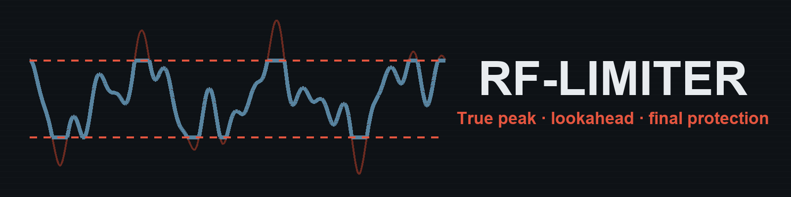

# RF-Limiter

RF-Limiter is a stereo lookahead limiter for RackForge. It reduces short peaks as the signal approaches the ceiling. With **True Peak** enabled, it also estimates peaks that can occur between digital samples.

## Install

RF-Limiter is included in the RackForge Standard bundle. To install it separately, download `RF-Limiter.rfplugin` and choose **Install plugin** in RackForge's **Plugin Manager**. [Download RF-Limiter](https://github.com/kalexis1994/rackforge-plugin-rf-limiter/releases/latest)

## Catch the peaks

1. Open the instrument's **Effects** in PLAY and choose **Add effect → RF-Limiter**. Place it last in the chain. Start with **Transparent** for a ceiling of −1 dBTP, **Safety** for more headroom, or **Stage** for a louder starting point.
2. Play your loudest passage. Watch **Input Peak**, **Output Peak** and **Gain Reduction**. Raise **Input** if you want more level to reach the limiter. Set **Ceiling** for the peak level you want at the effect's output.
3. Adjust **Lookahead** to give the limiter more time to react to an attack. Longer settings add latency. **Release** controls how quickly the gain returns after a peak. **Auto Release** adapts that timing to the signal.
4. Use **Delta Listen** to hear what the limiter removes. Return to normal playback to judge how much of the original attack comes through.

**Stereo Link** makes the channels reduce gain together, which helps keep the stereo image steady when a peak lands on one side.

## License

RF-Limiter is distributed under GPL-3.0-only. [License](LICENSE) · [Notices](NOTICE.md)
